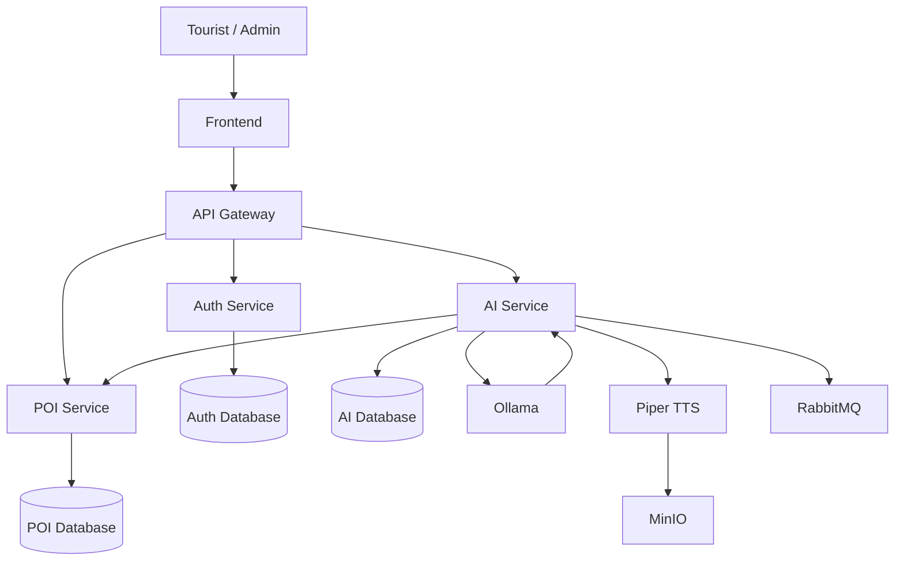

# group03-se-cicd-services
# Tourism Management System – Group 03
Hệ thống hỗ trợ khách du lịch tra cứu địa điểm tham quan (POI), tìm hiểu thông tin địa điểm và nghe nội dung thuyết minh được tạo bằng AI.

Dự án được xây dựng theo kiến trúc **Microservices**, sử dụng Docker để đóng gói và triển khai các thành phần, đồng thời áp dụng CI/CD để tự động hóa quy trình kiểm tra, build và phát hành Docker images.

# Thành viên:
- Trương Diểm My: 3124411170
- Phan Minh Phúc: 3124411238
- Lê Thị Thu Hoài: 3124411097
---

## 1. Project Overview

Hệ thống cung cấp hai giao diện chính:

- **Tourist Interface:** Dành cho khách du lịch truy cập website, xem địa điểm tham quan, tìm kiếm POI, sử dụng GPS và nghe thuyết minh.
- **Admin Interface:** Dành cho quản trị viên đăng nhập, quản lý POI, quản lý tour, theo dõi phiên truy cập và xem thống kê.

## 2. Main Features

### Tourist Features
- Truy cập website thông qua QR Code.
- Hỗ trợ lựa chọn ngôn ngữ giao diện độc lập với ngôn ngữ thuyết minh.
- Hiển thị danh sách và thông tin chi tiết POI.
- Tìm kiếm địa điểm tham quan theo dữ liệu của hệ thống (có định vị quét địa điểm trong bán kính 4km).
- Hỗ trợ quyền truy cập GPS.
- Yêu cầu tạo nội dung thuyết minh bằng AI.
- Chuyển nội dung thuyết minh thành âm thanh.
- Phát audio cho khách du lịch.

### Admin Features
- Đăng nhập và xác thực bằng JWT.
- Dashboard quản trị.
- Quản lý POI (Create, Read, Update).
- Quản lý tour và các địa điểm thuộc tour.
- Theo dõi phiên truy cập.
- Theo dõi trạng thái GPS.
- Quản lý bản đồ GPS.
- Xem báo cáo và thống kê hoạt động (địa điểm được chọn nhiều nhất).

## 3. System Architecture

Dự án sử dụng kiến trúc Microservices, trong đó mỗi service chịu trách nhiệm xử lý một nhóm nghiệp vụ riêng.

### Main Components

| Component | Responsibility |
|---|---|
| Frontend | Giao diện khách du lịch và Admin |
| API Gateway | Tiếp nhận và định tuyến API requests |
| Auth Service | Xác thực và quản lý tài khoản Admin |
| POI Service | Quản lý POI, tour và phiên truy cập |
| AI Service | Điều phối quá trình tạo nội dung thuyết minh và audio |
| Ollama | Tạo nội dung thuyết minh bằng mô hình ngôn ngữ |
| Piper TTS | Chuyển văn bản thành âm thanh |
| PostgreSQL | Lưu trữ dữ liệu nghiệp vụ |
| MinIO | Lưu trữ file audio |
| RabbitMQ | Hỗ trợ xử lý bất đồng bộ |
| Docker | Đóng gói và quản lý môi trường chạy dịch vụ |

### Architecture Diagram



## 4. Database Architecture

Hệ thống sử dụng PostgreSQL và phân chia dữ liệu thành ba database theo trách nhiệm của từng service.

| Database | Service | Stored Data |
|---|---|---|
| Auth Database | Auth Service | Tài khoản Admin, vai trò và quyền |
| POI Database | POI Service | POI, tour, quan hệ tour - POI, phiên truy cập và dữ liệu thống kê |
| AI Database | AI Service | Nội dung thuyết minh, ngôn ngữ, trạng thái xử lý và thông tin tham chiếu audio |

**Database per Service:** Mỗi service chịu trách nhiệm quản lý dữ liệu thuộc phạm vi nghiệp vụ của mình. Các service trao đổi dữ liệu thông qua API hoặc cơ chế tích hợp phù hợp, thay vì truy cập trực tiếp database của service khác.

## 5. AI Audio Generation Workflow

Quy trình tạo nội dung thuyết minh và audio:

1. Khách du lịch chọn địa điểm và ngôn ngữ thuyết minh.
2. Frontend gửi yêu cầu đến API Gateway.
3. API Gateway chuyển yêu cầu đến AI Service.
4. AI Service gọi POI Service để lấy thông tin địa điểm.
5. AI Service gửi dữ liệu đến Ollama.
6. Ollama tạo nội dung thuyết minh.
7. Piper TTS chuyển văn bản thành file audio.
8. File audio được lưu trữ trên MinIO.
9. AI Service lưu thông tin tham chiếu cần thiết.
10. Frontend nhận kết quả và phát audio cho khách.

## 6. Technology Stack

| Category | Technologies |
|---|---|
| Frontend | React, JavaScript, CSS |
| Backend | .NET / ASP.NET Core |
| API Communication | REST API |
| Database | PostgreSQL |
| AI Model Runtime | Ollama |
| Text-to-Speech | Piper TTS |
| Object Storage | MinIO |
| Message Broker | RabbitMQ |
| Containerization | Docker, Docker Compose |
| CI/CD | GitHub Actions |
| Container Registry | GitHub Container Registry (GHCR) |
| Version Control | Git, GitHub |

## 7. Repository Structure

```text
group03-se-cicd-services/
│
├── .github/
│   └── workflows/
│       ├── ci.yml
│       └── cd.yml
│
├── frontend/
│   ├── src/
│   ├── public/
│   ├── Dockerfile
│   └── nginx.conf
│
├── backend/
│   ├── ApiGateway/
│   ├── AuthService/
│   ├── PoiService/
│   ├── AiService/
│   ├── docker-compose.yml
│   └── .env
│
└── README.md
```

## 8. CI/CD Pipeline

Dự án sử dụng GitHub Actions để tự động hóa quy trình CI/CD.

### Continuous Integration (CI)
- Kiểm tra thay đổi mã nguồn.
- Build các thành phần tương ứng.
- Phát hiện lỗi trong quá trình build.
- Hỗ trợ kiểm tra chất lượng trước khi merge Pull Request.

### Continuous Delivery (CD)
- Build Docker images cho các service.
- Đóng gói frontend và các backend services.
- Push Docker images lên GitHub Container Registry (GHCR).
- Quản lý image theo branch và commit SHA.

Các Docker images được phát hành:

- Frontend
- API Gateway
- Auth Service
- POI Service
- AI Service

### Git Workflow

Dự án sử dụng hai nhánh chính:

- `develop`: Nhánh tích hợp và phát triển tính năng.
- `main`: Nhánh chính chứa phiên bản đã được tích hợp và kiểm tra.

Quy trình làm việc:

```text
Feature Branch
      |
      v
   develop
      |
      v
  Pull Request
      |
      v
    main
      |
      v
  GitHub Actions
      |
      v
 Docker Images
      |
      v
     GHCR
```

Các thay đổi trên `main` được thực hiện thông qua Pull Request theo quy định bảo vệ nhánh.

## 9. Deployment

Các thành phần của hệ thống được đóng gói bằng Docker.

Docker Compose hỗ trợ khởi chạy các backend services và những thành phần phụ trợ cần thiết.

Frontend được build thành Docker image riêng và phục vụ thông qua Nginx.

Các biến môi trường và thông tin nhạy cảm cần được cấu hình riêng trong môi trường triển khai. Không commit file chứa secrets lên GitHub.

## 10. Project Scope

Dự án tập trung vào:

- Quản lý địa điểm tham quan.
- Quản lý tour.
- Hỗ trợ khách du lịch tra cứu thông tin.
- Ghi nhận phiên truy cập và trạng thái GPS.
- Tạo nội dung thuyết minh bằng AI.
- Chuyển văn bản thành âm thanh.
- Quản trị và thống kê hoạt động hệ thống.

---

## 11. Team

**Group 03 – Software Engineering**

Repository: `group03-se-cicd-services`

